# SIPUS-Del: Sistem Informasi Perpustakaan Kampus Del

Tugas Mandiri Praktikum Minggu 5, Pemrograman & Pengujian Web (12S3101),
Institut Teknologi Del. Dibuat dengan Laravel 11 memakai arsitektur MVC.

- **Nama:** Ventyola Rohati Napitupulu
- **NIM:** 12S24042

## Fitur

- CRUD Buku dan Kategori memakai `Route::resource` (7 aksi RESTful)
- Implicit Route Model Binding
- Relasi Eloquent: Kategori `hasMany` Buku, Buku `belongsTo` Kategori
- Eager loading (`with('kategori')`, `withCount('bukus')`) untuk mencegah N+1
- Validasi server-side (ISBN unik, judul minimal 5 karakter, stok minimal 0)
- Proteksi CSRF dan method spoofing di semua form
- Master layout `<x-layout>` bertema Del Purple, pagination, flash message, `@forelse`
- Seeder dan Factory: 5 kategori dan 20 buku

## Struktur MVC

| Lapisan | Lokasi |
|---|---|
| Model | `app/Models/Buku.php`, `app/Models/Kategori.php` |
| View | `resources/views/` (`components/layout.blade.php`, `buku/`, `kategori/`) |
| Controller | `app/Http/Controllers/BukuController.php`, `KategoriController.php` |

## Instalasi

Prasyarat: PHP 8.2+, Composer 2.x, ekstensi `pdo_sqlite`.

```bash
git clone https://github.com/USERNAME/ppw-2026-week5-NIM.git
cd ppw-2026-week5-NIM
composer install
copy .env.example .env
php artisan key:generate
php artisan migrate --seed
php artisan serve
```

Buka `http://127.0.0.1:8000`. Jika Laravel menanyakan pembuatan
`database/database.sqlite`, jawab **yes**.
Di Mac/Linux, ganti `copy` dengan `cp`.

## Keamanan

- **CSRF:** semua form memuat `@csrf`, dan form edit/hapus memakai
  `@method('PUT')` / `@method('DELETE')`.
- **XSS:** output Blade memakai `{{ }}` yang otomatis di-escape. Tidak ada
  pemakaian `{!! !!}` di proyek ini.
- **SQL Injection:** semua akses data lewat Eloquent dan Query Builder yang
  memakai prepared statement. Tidak ada query mentah yang menyambung input
  pengguna.
- **Mass assignment:** hanya kolom di `$fillable` yang dapat diisi massal.
- **`.env`:** tidak ikut repositori. Template tersedia di `.env.example`.

## Bukti Audit SQL

Perbandingan query sebelum dan sesudah eager loading (12 query menjadi 3)
ada di [docs/audit-sql.md](docs/audit-sql.md).

## Screenshot

| Daftar Buku | Error Validasi |
|---|---|
|  |  |

| Notifikasi Sukses | Daftar Kategori |
|---|---|
|  |  |

---

# Tahap 2 (Minggu 6): Sirkulasi, Query Builder, dan Autentikasi

Branch: `week6-db-session`

## Akun Uji

| Peran | Email | Kata sandi |
|---|---|---|
| Pustakawan | `pustakawan@del.ac.id` | `password123` |

Akun ini hanya untuk pengujian lokal dan dibuat oleh seeder.

## Instalasi (MySQL)

```bash
git clone -b week6-db-session https://github.com/VentyolaNapitupulu/ppw-2026-week5-12S24042.git
cd ppw-2026-week5-12S24042
composer install
copy .env.example .env
php artisan key:generate
```
Buat database kosong `sipus_del` di MySQL (utf8mb4), lalu:
```bash
php artisan migrate --seed
php artisan serve
```
Di Mac/Linux, ganti `copy` dengan `cp`.

## Fitur Tahap 2

- Tabel `peminjamans` (foreign key ke `bukus`, `cascadeOnDelete`) dan relasi Eloquent dua arah
- Peminjaman dan pengembalian dalam `DB::transaction()` dengan `lockForUpdate()`; stok 0, NIM ganda, dan klik ganda ditolak dengan rollback; `QueryException` dicatat ke `Log::error()`
- Katalog dengan `withCount('peminjamans')`, pencarian dinamis `when()` (judul/penulis/ISBN dan kategori), paginasi `withQueryString()`
- Empat kartu statistik lewat `DB::table()`
- Login pustakawan dengan `Auth::attempt()`, `session()->regenerate()` saat login, `invalidate()` dan `regenerateToken()` saat logout
- Middleware `auth` pada rute mutasi (CRUD buku/kategori, peminjaman, pengembalian)
- State di Session (pencarian terakhir, waktu login) dan cookie `del_last_user_email` lewat `Cookie::queue()`

## ERD

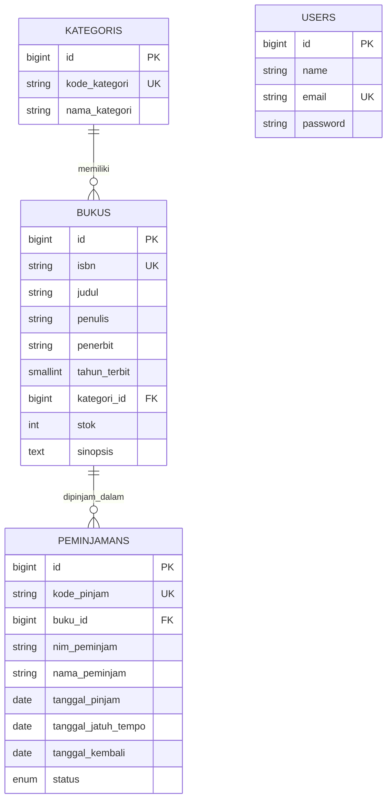

## Bukti Pengujian Transaksi ACID

Data uji berasal dari seeder: buku *Keamanan Aplikasi Web* (stok 1) dan *Rekayasa Perangkat Lunak Modern* (stok 0).

| Skenario | Hasil | Bukti |
|---|---|---|
| Pinjam buku stok 1 | Berhasil, stok menjadi 0 |  |
| Pinjam buku stok 0 | Ditolak, rollback, tidak ada baris baru |  |
| Kembalikan buku | Stok bertambah 1 |  |
| Klik Kembalikan dua kali | Ditolak; stok tidak bertambah dua kali | <br> |
| Belum login, buka /peminjaman	Dialihkan ke /login | Tidak bisa masuk ke akun |  |

## Audit Cookie dan Sesi

Cookie `laravel_session` dan `del_last_user_email` memiliki atribut **HttpOnly** dan **SameSite=Lax**. `XSRF-TOKEN` sengaja tidak HttpOnly agar token CSRF dapat dibaca klien. Atribut Secure tidak aktif karena pengujian memakai HTTP lokal.


ID sesi pada tabel `sessions` berganti setelah login (`regenerate()`), dan baris sesi pengguna hilang setelah logout (`invalidate()`).

## Catatan

- Penguncian baris `lockForUpdate()` sepenuhnya bekerja pada MySQL (InnoDB). Pada SQLite, kueri kunci diabaikan dan seluruh berkas dikunci saat penulisan.
- Kolom `stok` bertipe `unsigned` sebagai pengaman kedua di samping pengecekan di kode.

---

# Tahap 3 (Minggu 9): Web Services & REST API

Branch: `week9-rest-api`

## Analisis Kebutuhan & Kelayakan Web Services

### Peran SIPUS-Del dalam Ekosistem Layanan

| Kebutuhan Integrasi | Peran SIPUS-Del | Pihak Lain | Alasan |
|---|---|---|---|
| Cek bebas pustaka untuk yudisium | **Provider (SOAP)** | Sistem Yudisium legacy (Consumer) | Data pinjaman adalah domain sah perpustakaan; sistem yudisium cukup menerima jawaban bebas/belum bebas tanpa mengakses tabel kami. |
| Aplikasi Mobile & Kiosk Perpustakaan | **Provider (REST)** | Aplikasi Mobile/Kiosk (Consumer) | Katalog dan sirkulasi adalah milik perpustakaan; klien baru cukup memanggil API tanpa menyentuh database. |
| Metadata buku (halaman, sampul, penerbit) | **Consumer (REST)** | OpenLibrary API (Provider) | Membangun basis metadata buku sedunia berada di luar domain inti dan jauh lebih mahal daripada memakai layanan publik yang sudah ada. |

### Mengapa SOAP untuk Yudisium?

Sistem Yudisium sudah berjalan dan hanya mampu berkomunikasi lewat SOAP XML.
Mengubah sistem tersebut lebih mahal dan berisiko daripada menyediakan satu
endpoint SOAP. Karena hanya ada satu operasi sederhana (`CheckClearanceStatus`),
ukuran XML yang besar tidak menjadi masalah, dan kontrak WSDL memudahkan
sistem legacy membuat client stub secara otomatis.

### Mengapa REST untuk Mobile/Kiosk?

| Aspek | SOAP | REST (dipilih) |
|---|---|---|
| Ukuran payload | Besar (amplop XML) | Ringkas (JSON), hemat kuota data mahasiswa |
| Operasi | Hanya POST | GET/POST/PUT/PATCH/DELETE sesuai semantik |
| Cache | Tidak bisa (semua POST) | Katalog GET dapat di-cache |
| Dukungan klien | Butuh library SOAP | JSON didukung langsung di Flutter, Kotlin, JavaScript |
| State | Umumnya stateless | Wajib stateless (Bearer Token), mudah diskalakan untuk banyak kiosk |

Kiosk dan aplikasi mobile lebih banyak membaca katalog dan melakukan transaksi
singkat. REST dengan JSON lebih ringan, lebih cepat diproses, dan lebih mudah
dikembangkan tim mobile, sehingga REST lebih layak dibanding SOAP.

## Endpoint SOAP Bebas Pustaka

| Method | URI | Keterangan |
|---|---|---|
| GET | `/soap/sipus.wsdl` | Kontrak WSDL operasi `CheckClearanceStatus` |
| POST | `/soap/sipus` | Menerima `<nim_peminjam>`, mengembalikan `<active_loans>` & `<is_cleared>` |

NIM yang belum pernah meminjam dianggap **bebas pustaka** (`is_cleared = true`),
bukan galat. `<soap:Fault>` (HTTP 500, sesuai SOAP 1.1) hanya dikirim bila body
kosong, XML cacat, operasi tidak dikenali, atau `<nim_peminjam>` kosong.

| Skenario | Bukti |
|---|---|
| Kontrak WSDL | 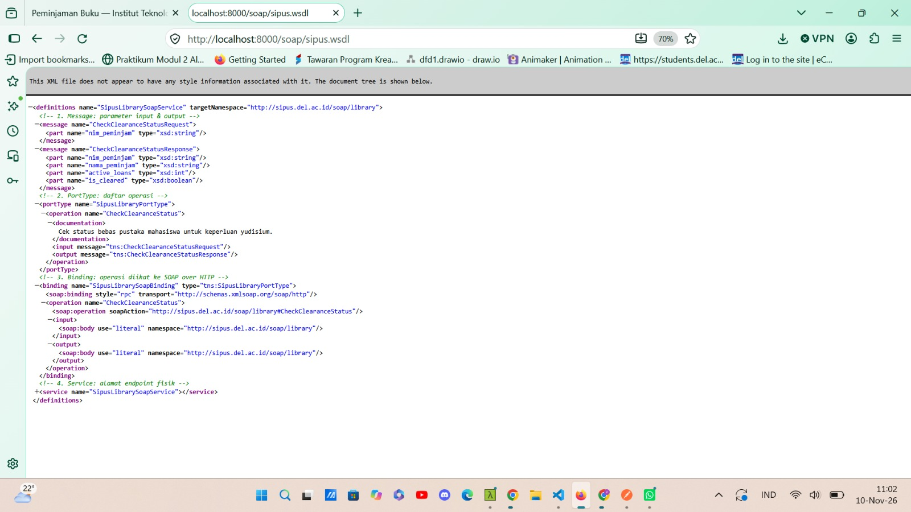 |
| Masih punya pinjaman (`is_cleared=false`) | 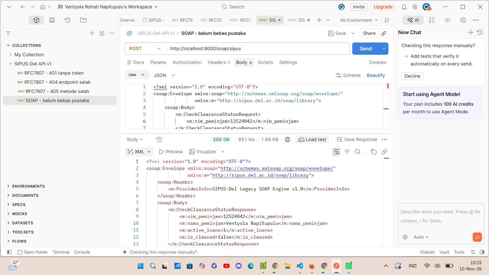 |
| Bebas pustaka (`is_cleared=true`) | 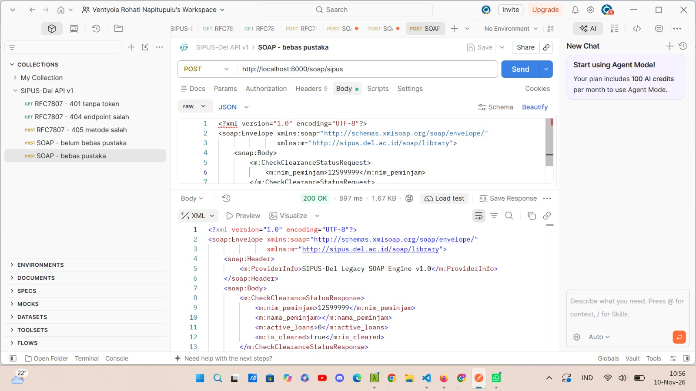 |
| Fault: NIM kosong | 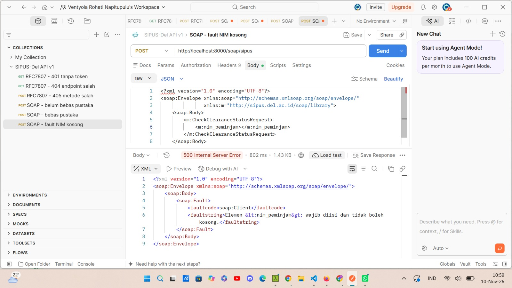 |
| Fault: XML cacat | 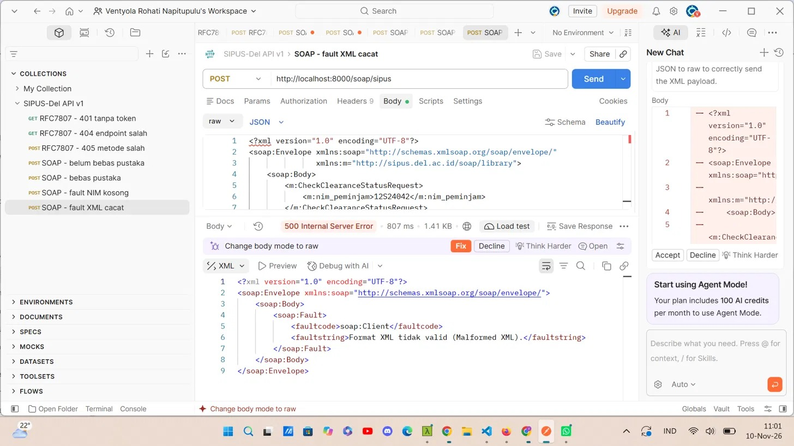 |


## Standar Galat API (RFC 7807)

Seluruh galat pada `/api/*` ditangani satu pintu di `bootstrap/app.php` dan
selalu dikembalikan sebagai `application/problem+json` dengan atribut
`type`, `title`, `status`, `detail`, dan `instance` (ditambah `errors` untuk 422).
Halaman web Blade Minggu 6 tidak terpengaruh.

| Status | Kapan |
|---|---|
| 401 | Bearer Token tidak ada, salah, kedaluwarsa, atau sudah dicabut |
| 403 | Token valid tetapi tidak berhak |
| 404 | Endpoint atau resource tidak ditemukan |
| 405 | Metode HTTP tidak diizinkan pada endpoint |
| 409 | Konflik state bisnis (mis. pinjaman ganda) |
| 422 | Validasi input gagal |
| 429 | Melebihi batas percobaan (rate limit) |
| 500 | Kesalahan server (pesan internal disembunyikan jika `APP_DEBUG=false`) |

| Bukti | |
|---|---|
| 401 tanpa token (`application/problem+json`) | 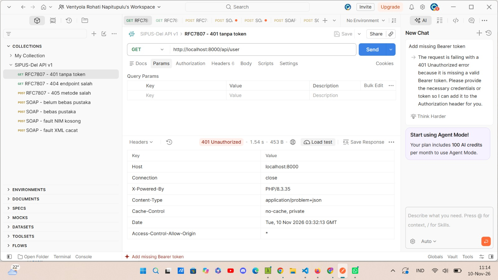 |


## Otentikasi Stateless (Laravel Sanctum Bearer Token)

| Method | URI | Auth | Keterangan | Status |
|---|---|---|---|---|
| POST | `/api/v1/auth/login` | Publik (maks. 5x/menit) | Verifikasi email & password, terbitkan token berlaku 8 jam | 200, 401, 422, 429 |
| GET | `/api/v1/auth/me` | Bearer | Profil pemilik token + info token | 200, 401 |
| POST | `/api/v1/auth/logout` | Bearer | Cabut (revoke) token yang sedang dipakai | 200, 401 |

Server tidak menyimpan sesi. Setiap request membawa identitasnya sendiri lewat
header `Authorization: Bearer <token>`. Setelah logout, token yang sama langsung
ditolak 401 karena barisnya sudah dihapus dari tabel `personal_access_tokens`.

Di Postman, token disimpan otomatis ke variabel koleksi `{{token}}` oleh script
*After response* pada request login, lalu diwarisi semua request terproteksi.

| Bukti | |
|---|---|
| Login berhasil (token disensor) | 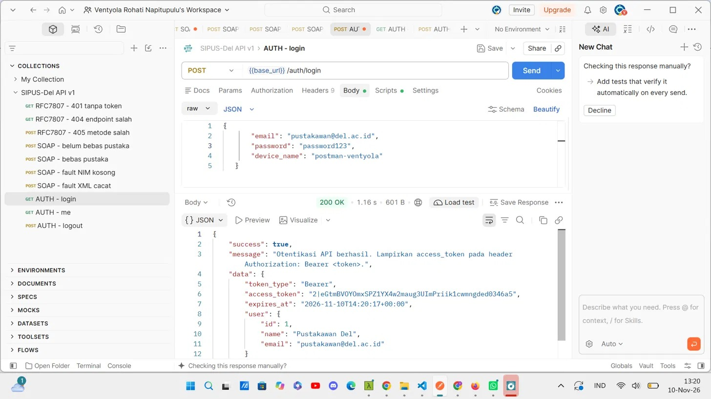 |
| Profil pemilik token | 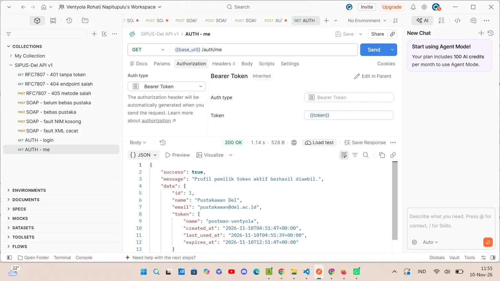 |
| Token setelah logout ditolak 401 | 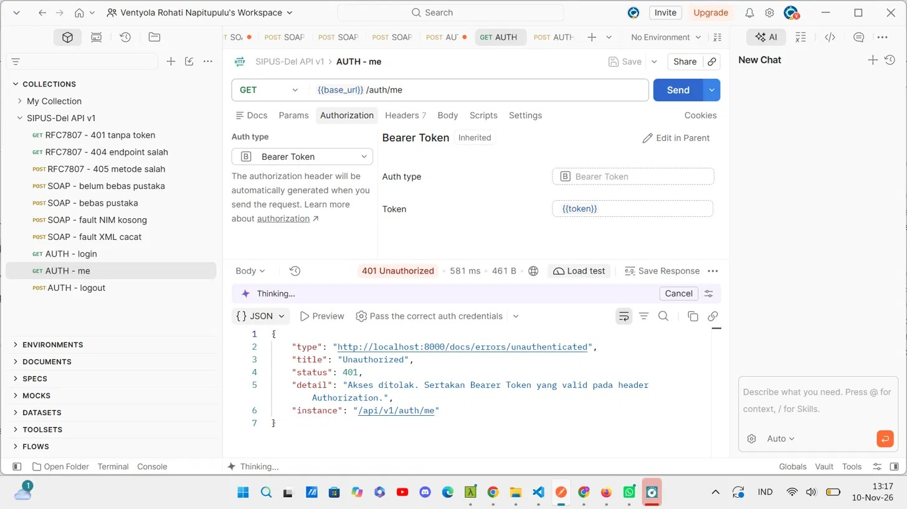 |
| Validasi gagal 422 (RFC 7807) | 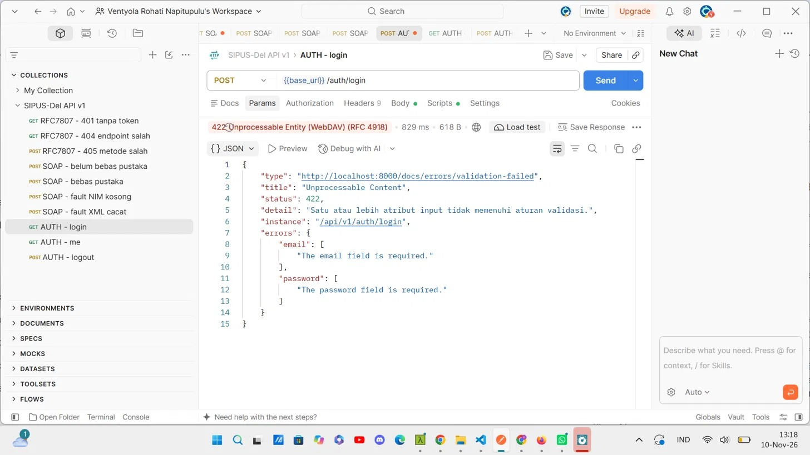 |