# SIPUS-Del: Sistem Informasi Perpustakaan Kampus Del

Tugas Mandiri Praktikum Minggu 5, Pemrograman & Pengujian Web (12S3101),
Institut Teknologi Del. Dibuat dengan Laravel 11 memakai arsitektur MVC.

- **Nama:** Ventyola Rohati Napitupulu
- **NIM:** 12S24042

## Fitur

- CRUD Buku dan Kategori memakai `Route::resource` (7 aksi RESTful)
- Implicit Route Model Binding
- Relasi Eloquent: Kategori `hasMany` Buku, Buku `belongsTo` Kategori
- Eager loading (`with('kategori')`, `withCount('bukus')`) untuk mencegah N+1
- Validasi server-side (ISBN unik, judul minimal 5 karakter, stok minimal 0)
- Proteksi CSRF dan method spoofing di semua form
- Master layout `<x-layout>` bertema Del Purple, pagination, flash message, `@forelse`
- Seeder dan Factory: 5 kategori dan 20 buku

## Struktur MVC

| Lapisan | Lokasi |
|---|---|
| Model | `app/Models/Buku.php`, `app/Models/Kategori.php` |
| View | `resources/views/` (`components/layout.blade.php`, `buku/`, `kategori/`) |
| Controller | `app/Http/Controllers/BukuController.php`, `KategoriController.php` |

## Instalasi

Prasyarat: PHP 8.2+, Composer 2.x, ekstensi `pdo_sqlite`.

```bash
git clone https://github.com/USERNAME/ppw-2026-week5-NIM.git
cd ppw-2026-week5-NIM
composer install
copy .env.example .env
php artisan key:generate
php artisan migrate --seed
php artisan serve
```

Buka `http://127.0.0.1:8000`. Jika Laravel menanyakan pembuatan
`database/database.sqlite`, jawab **yes**.
Di Mac/Linux, ganti `copy` dengan `cp`.

## Keamanan

- **CSRF:** semua form memuat `@csrf`, dan form edit/hapus memakai
  `@method('PUT')` / `@method('DELETE')`.
- **XSS:** output Blade memakai `{{ }}` yang otomatis di-escape. Tidak ada
  pemakaian `{!! !!}` di proyek ini.
- **SQL Injection:** semua akses data lewat Eloquent dan Query Builder yang
  memakai prepared statement. Tidak ada query mentah yang menyambung input
  pengguna.
- **Mass assignment:** hanya kolom di `$fillable` yang dapat diisi massal.
- **`.env`:** tidak ikut repositori. Template tersedia di `.env.example`.

## Bukti Audit SQL

Perbandingan query sebelum dan sesudah eager loading (12 query menjadi 3)
ada di [docs/audit-sql.md](docs/audit-sql.md).

## Screenshot

| Daftar Buku | Error Validasi |
|---|---|
| 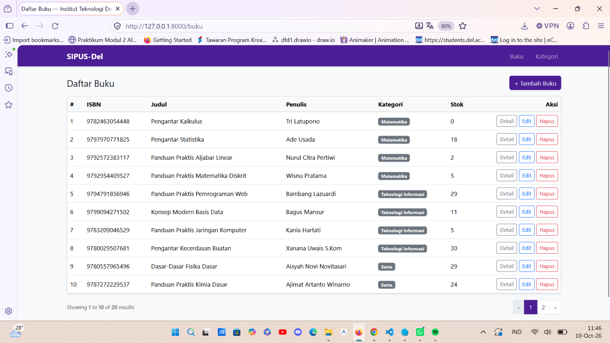 | 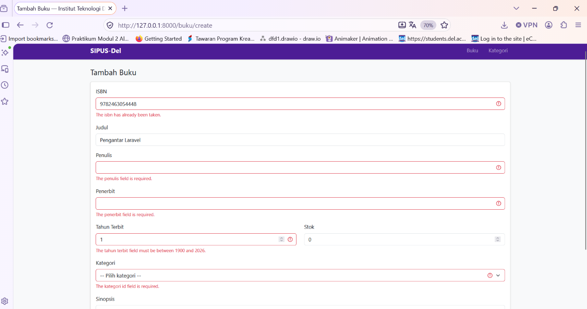 |

| Notifikasi Sukses | Daftar Kategori |
|---|---|
| 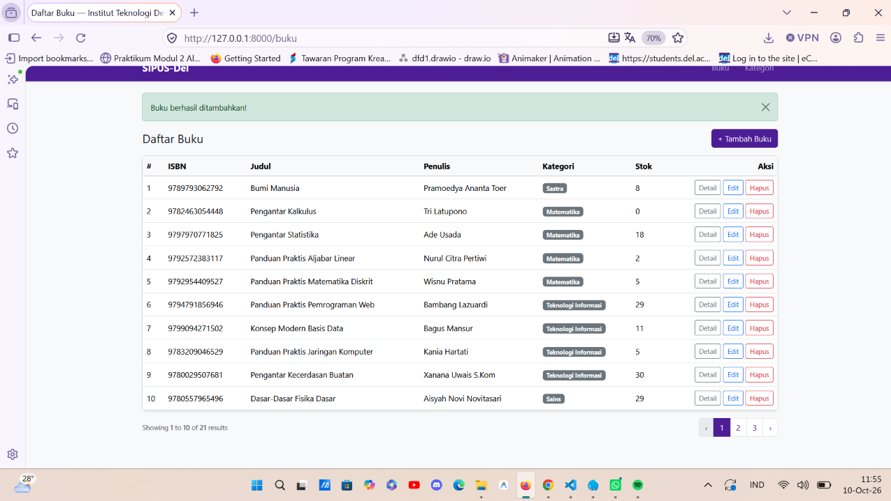 | 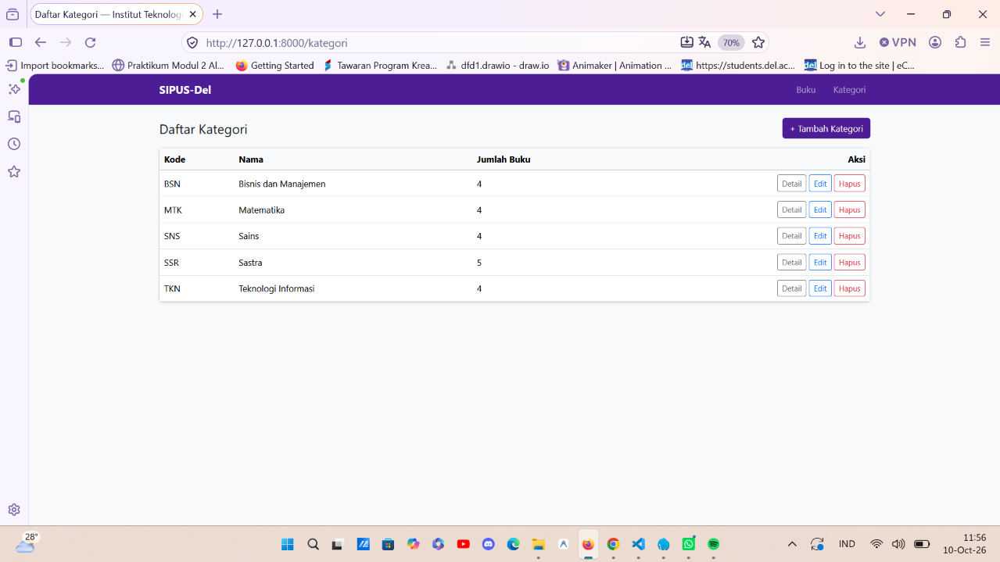 |

---

# Tahap 2 (Minggu 6): Sirkulasi, Query Builder, dan Autentikasi

Branch: `week6-db-session`

## Akun Uji

| Peran | Email | Kata sandi |
|---|---|---|
| Pustakawan | `pustakawan@del.ac.id` | `password123` |

Akun ini hanya untuk pengujian lokal dan dibuat oleh seeder.

## Instalasi (MySQL)

```bash
git clone -b week6-db-session https://github.com/VentyolaNapitupulu/ppw-2026-week5-12S24042.git
cd ppw-2026-week5-12S24042
composer install
copy .env.example .env
php artisan key:generate
```
Buat database kosong `sipus_del` di MySQL (utf8mb4), lalu:
```bash
php artisan migrate --seed
php artisan serve
```
Di Mac/Linux, ganti `copy` dengan `cp`.

## Fitur Tahap 2

- Tabel `peminjamans` (foreign key ke `bukus`, `cascadeOnDelete`) dan relasi Eloquent dua arah
- Peminjaman dan pengembalian dalam `DB::transaction()` dengan `lockForUpdate()`; stok 0, NIM ganda, dan klik ganda ditolak dengan rollback; `QueryException` dicatat ke `Log::error()`
- Katalog dengan `withCount('peminjamans')`, pencarian dinamis `when()` (judul/penulis/ISBN dan kategori), paginasi `withQueryString()`
- Empat kartu statistik lewat `DB::table()`
- Login pustakawan dengan `Auth::attempt()`, `session()->regenerate()` saat login, `invalidate()` dan `regenerateToken()` saat logout
- Middleware `auth` pada rute mutasi (CRUD buku/kategori, peminjaman, pengembalian)
- State di Session (pencarian terakhir, waktu login) dan cookie `del_last_user_email` lewat `Cookie::queue()`

## ERD

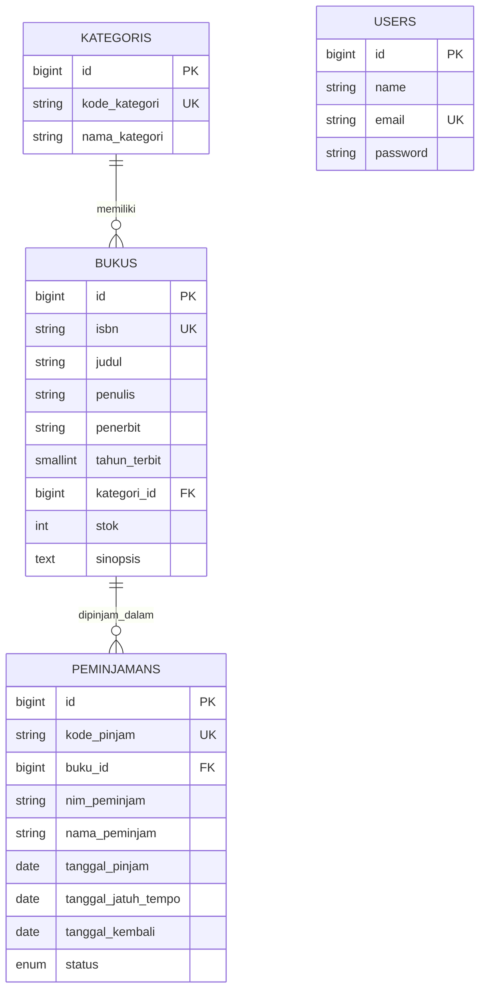

## Bukti Pengujian Transaksi ACID

Data uji berasal dari seeder: buku *Keamanan Aplikasi Web* (stok 1) dan *Rekayasa Perangkat Lunak Modern* (stok 0).

| Skenario | Hasil | Bukti |
|---|---|---|
| Pinjam buku stok 1 | Berhasil, stok menjadi 0 | 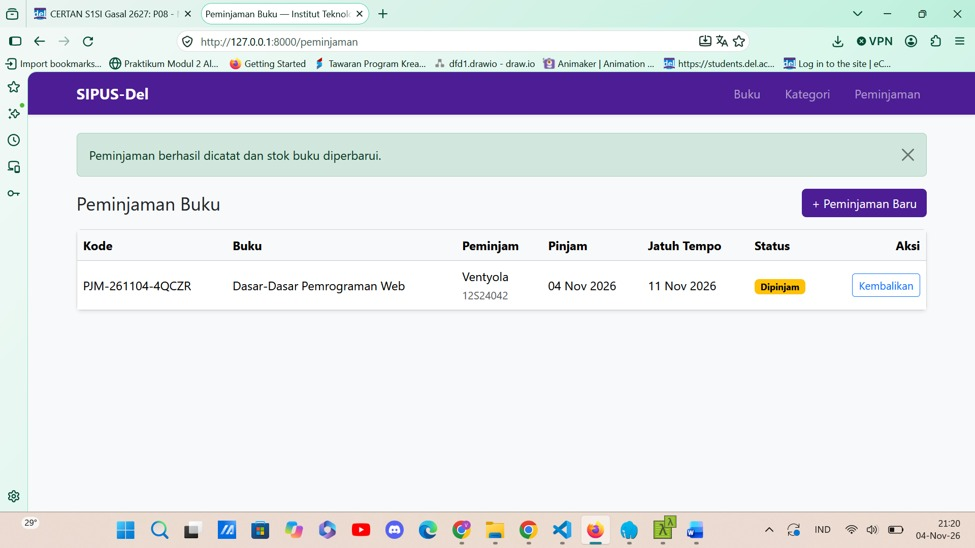 |
| Pinjam buku stok 0 | Ditolak, rollback, tidak ada baris baru | 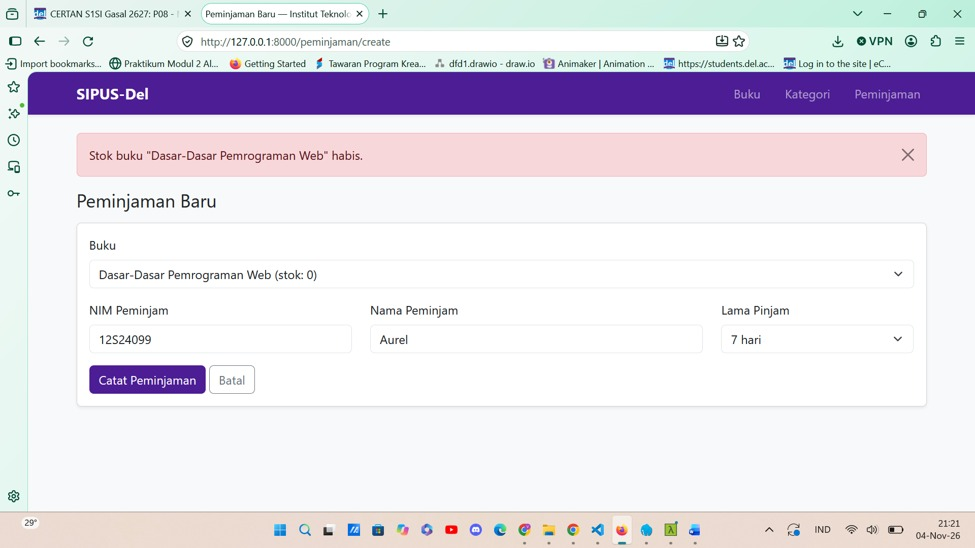 |
| Kembalikan buku | Stok bertambah 1 | 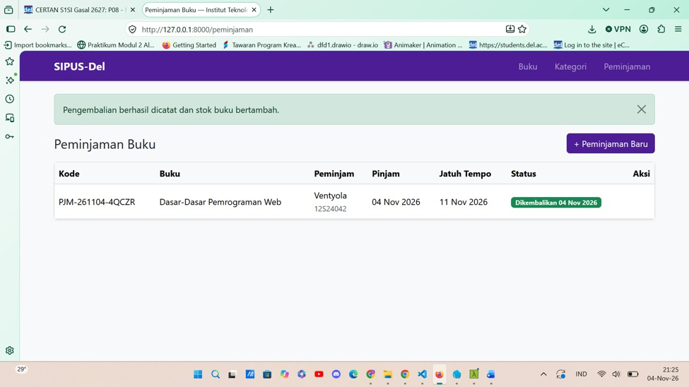 |
| Klik Kembalikan dua kali | Ditolak; stok tidak bertambah dua kali | 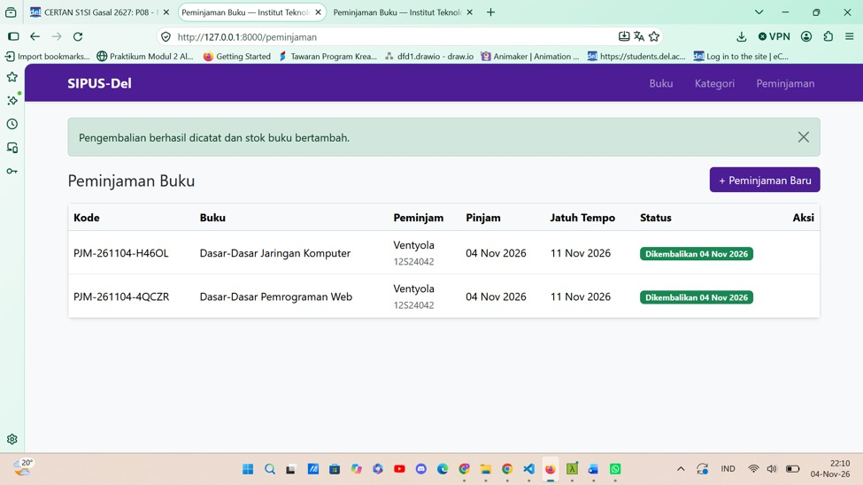<br>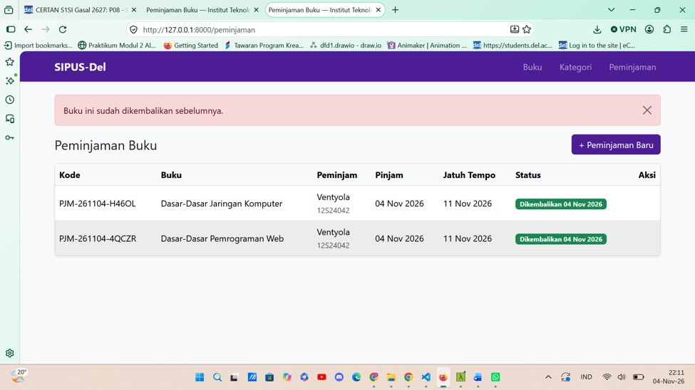 |
| Belum login, buka /peminjaman	Dialihkan ke /login | Tidak bisa masuk ke akun | 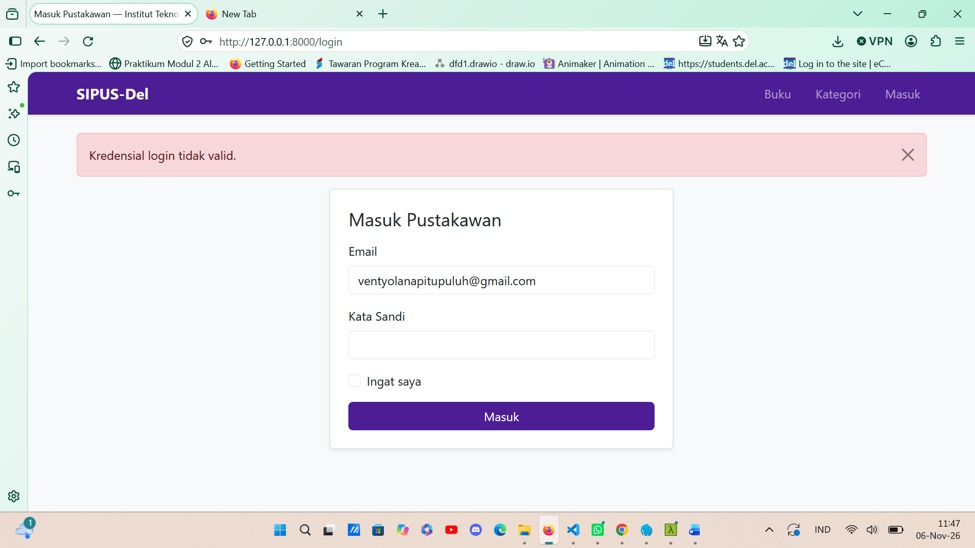 |

## Audit Cookie dan Sesi

Cookie `laravel_session` dan `del_last_user_email` memiliki atribut **HttpOnly** dan **SameSite=Lax**. `XSRF-TOKEN` sengaja tidak HttpOnly agar token CSRF dapat dibaca klien. Atribut Secure tidak aktif karena pengujian memakai HTTP lokal.


ID sesi pada tabel `sessions` berganti setelah login (`regenerate()`), dan baris sesi pengguna hilang setelah logout (`invalidate()`).

## Catatan

- Penguncian baris `lockForUpdate()` sepenuhnya bekerja pada MySQL (InnoDB). Pada SQLite, kueri kunci diabaikan dan seluruh berkas dikunci saat penulisan.
- Kolom `stok` bertipe `unsigned` sebagai pengaman kedua di samping pengecekan di kode.